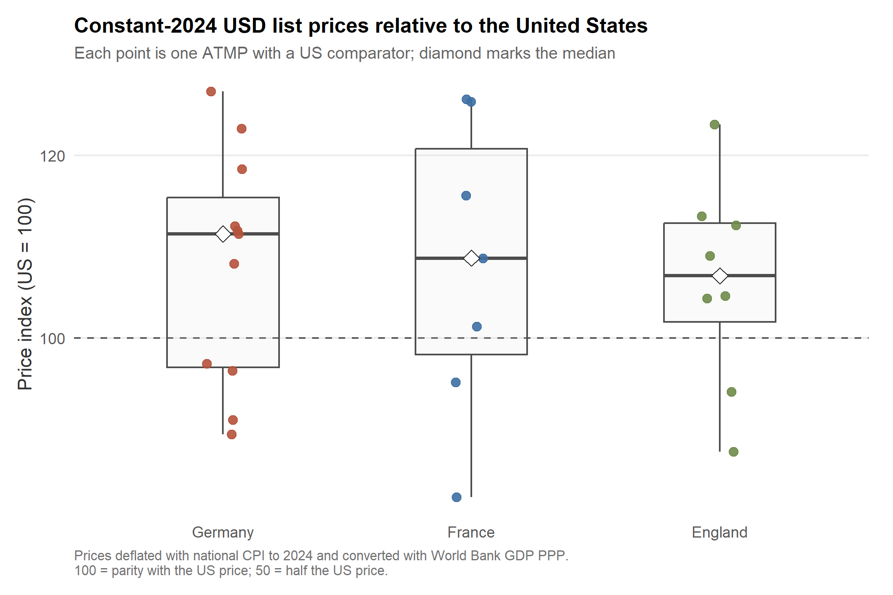
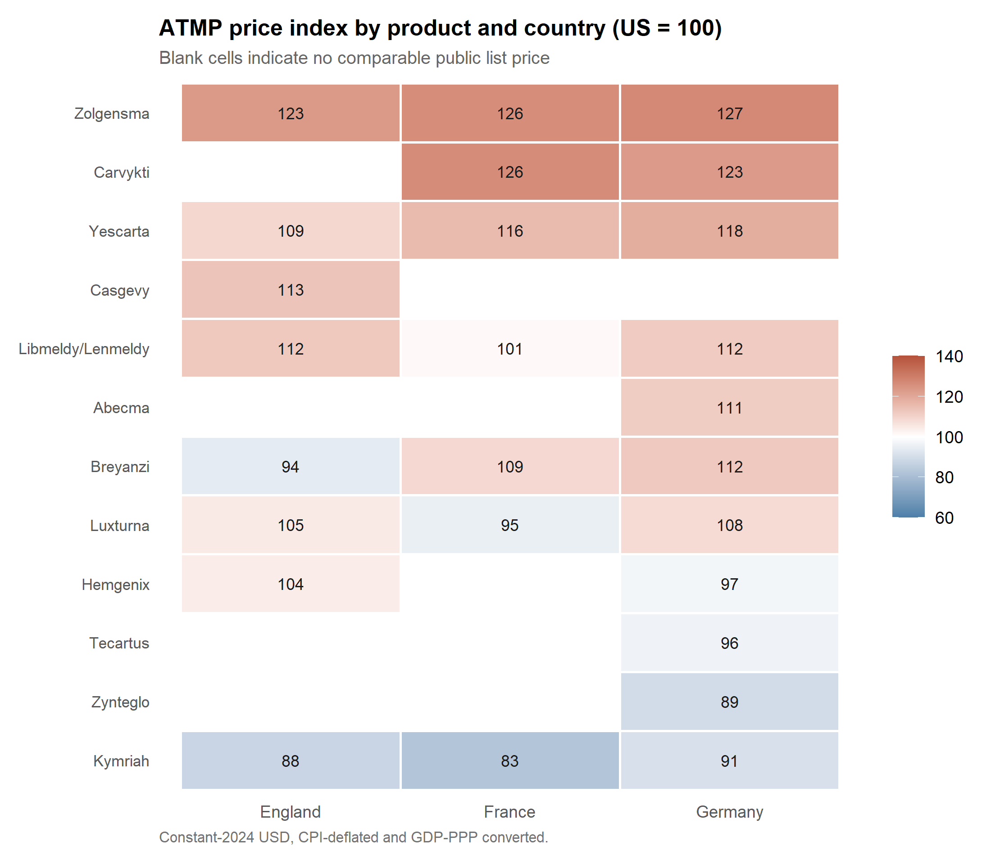
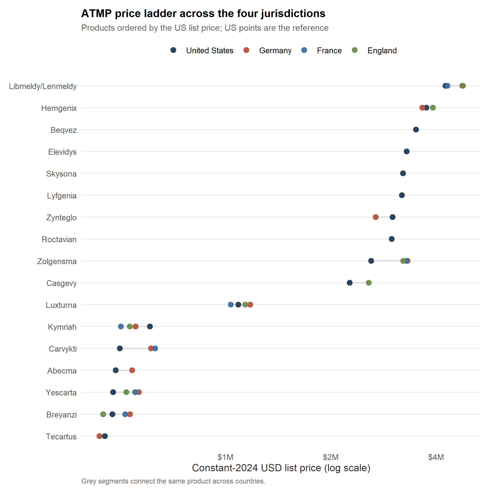
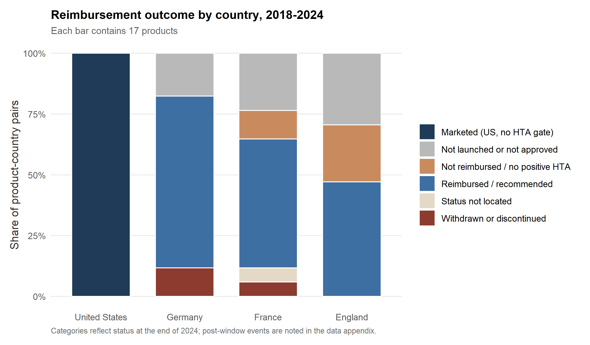
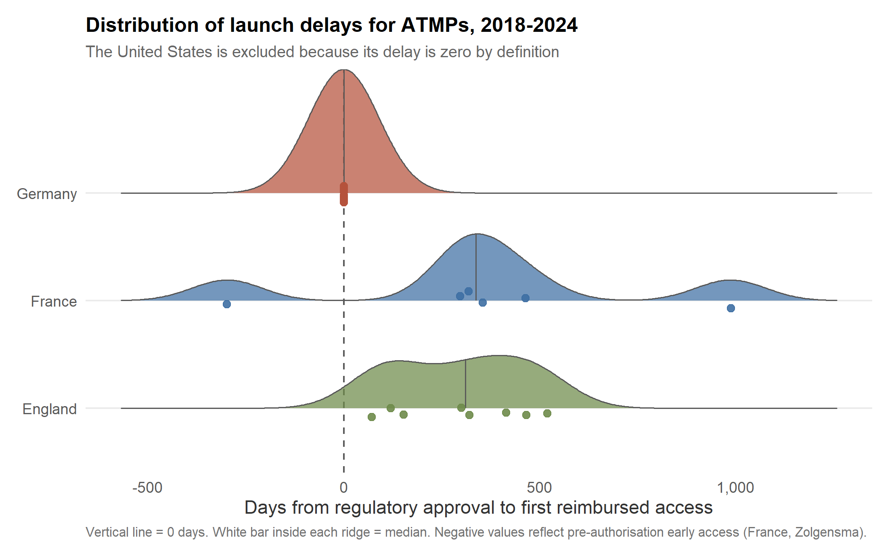
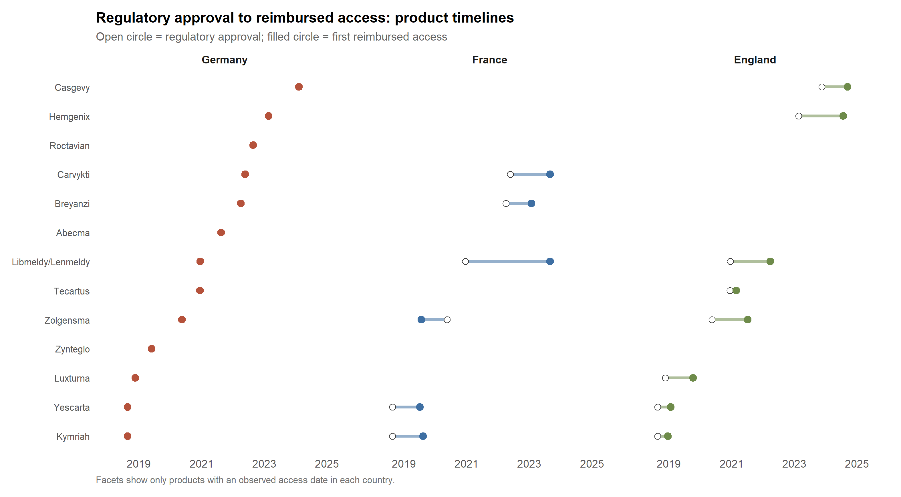
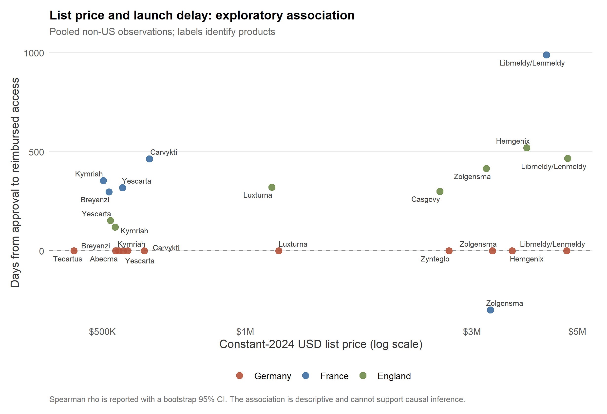
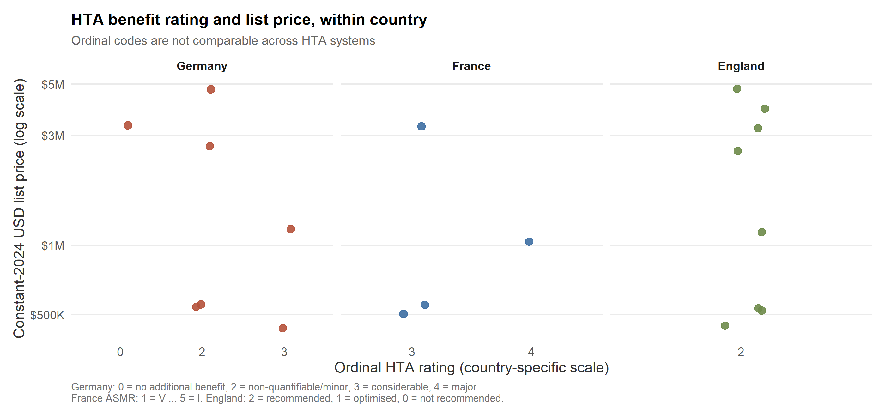
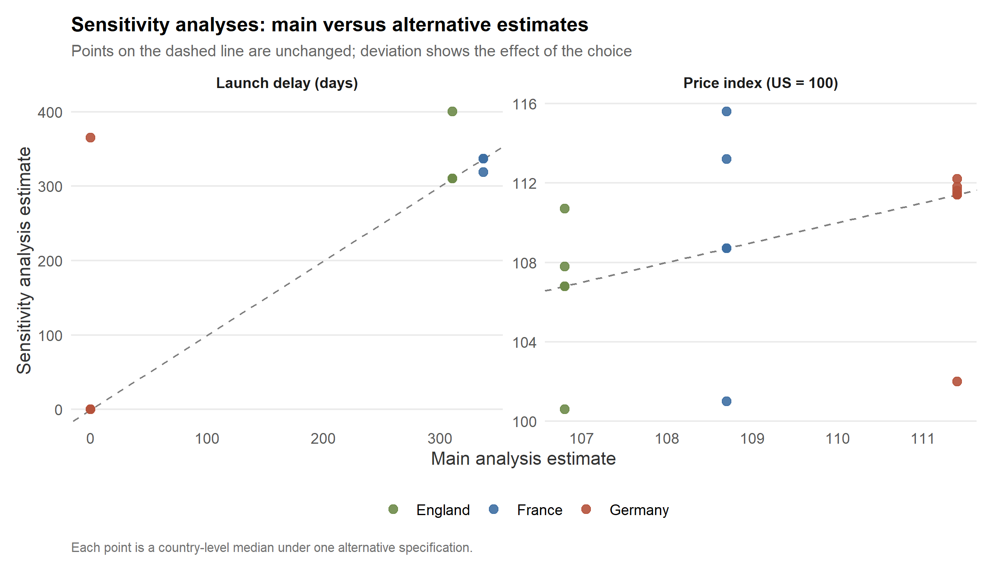

<div class="titlepage">
<p class="doctitle">A Comparative Policy Analysis of ATMP Pricing and Access</p>
<p class="subtitle">List prices, launch sequencing, and patient access for advanced therapy medicinal products across the United States, Germany, France, and England, 2018&ndash;2024</p>
<p class="meta">Zoubayda Baoubbou &middot; Health Economics and Outcomes Research</p>
<p class="meta">Final report &middot; 14 November 2026</p>
</div>

# Executive summary

Advanced therapy medicinal products (ATMPs) are one-time treatments whose prices routinely exceed one million US dollars. This study built a harmonised drug &times; country dataset covering 17 ATMPs approved by the FDA and/or EMA between 2017 and 2024, across four jurisdictions with fundamentally different access architectures: the United States, Germany, France, and England. The final dataset contains 68 product&ndash;country pairs, of which 43 have an observed public list price and 27 have an analysable launch delay outside the United States. Prices were deflated in local currency using national consumer price indices, converted to constant-2024 international dollars using GDP-based purchasing power parities, and expressed as an index with the United States equal to 100. All analyses are descriptive or exploratory; no regression modelling was performed.

**Principal findings.**

1. **After inflation and PPP adjustment, European list prices are close to US prices, not uniformly lower.** Median price indices were 111.4 in Germany (IQR 96.8&ndash;115.4), 108.7 in France (98.2&ndash;120.7), and 106.8 in England (101.8&ndash;112.6). On a balanced six-product panel the medians were 112.0, 105.0, and 106.8, so the result is not an artefact of different price coverage. Between 64% and 75% of priced products in each European jurisdiction had a constant-USD list price at or above the US price. The familiar claim that US list prices are far higher than European prices does not survive a like-for-like PPP comparison at launch.

2. **Kymriah is the main exception.** Its adjusted price was 17% below the US price in France, 12% below in England, and 9% below in Germany. Zolgensma, by contrast, was priced 23&ndash;27% above the US level in all three European jurisdictions.

3. **Germany's zero launch delay is definitional, not evidence of faster access.** Under AMNOG, products enter at a manufacturer-set free price on the day of EMA approval; the median delay is therefore 0 days by construction (n = 13). When access is redefined as the end of the 12-month free-pricing period, Germany becomes the slowest jurisdiction in the comparison (365 days), ahead of France (337 days) and England (311 days).

4. **England and France cluster at roughly ten to eleven months from approval to reimbursed access, with long tails.** Median delays were 310.5 days in England (IQR 144.8&ndash;427.8) and 337 days in France (IQR 302.5&ndash;436.8). Only 1 of 8 English and 1 of 6 French observations achieved access within 90 days, compared with all 13 German observations.

5. **The price&ndash;delay association is weak and imprecise overall but strong within England.** The pooled Spearman &rho; was 0.15 (bootstrap 95% CI &minus;0.33 to 0.57; n = 24). Within England, &rho; was 0.89 (95% CI 0.41 to 1.00; n = 7), consistent with a budget-shock mechanism in which the most expensive products wait longest for NICE and NHS England agreement. With seven observations this is suggestive, not confirmatory.

6. **Approval is not access.** Only 29 of 68 product&ndash;country pairs reached a reimbursed or recommended status. Twelve pairs were never launched or never approved in the jurisdiction, six were not reimbursed or had a negative/terminated appraisal, and three were withdrawn. Zynteglo and Skysona were withdrawn from Europe; Roctavian and Beqvez were discontinued; Abecma and Carvykti had their NICE appraisals terminated.

7. **Price transparency is limited.** Only 63% of pairs had an observed list price, and six prices were explicitly confidential. The United States had complete price coverage (17/17), Germany 11/17, France 7/17, and England 8/17.

The central policy message is that list prices have converged internationally at launch while access timelines and access success have not. European payers appear willing to accept near-US list prices, then recover affordability through confidential discounts, outcomes-based agreements, and managed access. The binding constraint is not the headline price alone but the institutional process that converts a marketing authorisation into a funded patient treatment.

# Background

ATMPs&mdash;cell therapies, gene therapies, and gene-edited cell therapies&mdash;represent a rapidly expanding class of treatments that are administered once, or a few times, with the intention of producing durable clinical benefit. Since the first approvals in 2017 (tisagenlecleucel/Kymriah, axicabtagene ciloleucel/Yescarta, and voretigene neparvovec/Luxturna), more than a dozen products have received marketing authorisation from the FDA and/or the EMA, with launch prices ranging from approximately USD 475,000 to more than USD 4 million per course [@fda_cber; @ema_atmp]. These products challenge pricing and reimbursement systems that were designed for chronic, repeat-prescription medicines.

The four jurisdictions in this analysis differ in how a regulatory approval becomes a funded treatment. The United States has no national health technology assessment (HTA) gate: FDA approval permits marketing, but patient access depends on fragmented coverage decisions by commercial insurers, Medicare, Medicaid, and providers. Germany's AMNOG system grants immediate market access at a manufacturer-set free price for approximately the first 12 months; the G-BA then assesses additional benefit and the GKV-Spitzenverband negotiates a confidential rebate, often with outcomes-based elements [@gba_amnog]. France operates a sequential system in which the HAS Transparency Commission issues an SMR/ASMR opinion, the CEPS negotiates a reimbursable price, and formal reimbursement follows; earlier access may occur through temporary-use authorisations (ATU) [@has_ceps]. England relies on NICE technology appraisal, with a statutory duty for NHS England to fund recommended technologies, usually within 90 days of guidance publication [@nice_guidance].

These structural differences are expected to produce different access timelines and different degrees of price transparency. Cross-country comparisons have been limited by the absence of a harmonised dataset linking regulatory milestones, HTA decisions, and list prices under comparable definitions. Existing indicators, such as the EFPIA/IQVIA Patients W.A.I.T. Indicator, measure time to patient access but operationalise "access" differently across systems [@efpia_wait]. List prices&mdash;the only systematically observable price concept&mdash;are also confounded by confidential rebates in Germany, negotiated discounts in France, and commercial access agreements in England. List-price comparisons therefore capture the signalling function of pricing rather than true budget impact.

This study addresses three gaps. First, it builds a transparent, source-registered dataset in which every value can be traced to a named source and every missing value has a documented reason. Second, it applies a strict, reversible price transformation that separates within-country inflation from cross-country price-level differences. Third, it treats launch delay as a country-specific construct rather than forcing four institutional processes into a single unproblematic measure. The analysis does not attempt causal inference; it quantifies variation and documents where comparison is and is not valid.

# Research question and objectives

The primary research question is: how do publicly listed prices and the time from regulatory approval to reimbursed patient access for ATMPs vary across the United States, Germany, France, and England, and to what extent can observed variation be attributed to differences in HTA and reimbursement architecture?

The secondary questions are:

1. What is the magnitude of cross-country list-price differences for the same ATMP after PPP and inflation adjustment?
2. How long does it take from regulatory approval to first reimbursed availability in each country, and which countries are consistently faster or slower?
3. Is there an association between list price and launch delay (the budget-shock hypothesis)?
4. What happens to ATMPs that receive regulatory authorisation but fail to achieve sustainable reimbursement?

# Methods

## Study design and scope

This is a cross-sectional, descriptive comparative policy analysis. The unit of analysis is the drug &times; country pair. The maximum sample is 17 products &times; 4 countries = 68 observations, fewer where data are missing. The regulatory-approval window is 2017&ndash;2024, and the cross-country analytical window is 2018&ndash;2024. Scotland and Wales are excluded because they run separate HTA processes; the English analysis covers NICE and NHS England only.

## Product inclusion and exclusion

Products were eligible if they were classified as a cell therapy, gene therapy, or gene-edited cell therapy under EU Regulation (EC) No 1394/2007 or FDA CBER designation; received marketing authorisation from the FDA, EMA, and/or MHRA from 2017 onward; were commercially marketed rather than solely clinical-trial or compassionate-use products; and had at least one of list price, regulatory date, or HTA date observable in a primary or authoritative source. Products first approved before 2017, tissue-engineered products without gene modification, cord-blood products, and products regulated primarily as devices were excluded. Upadacitinib-type small molecules and non-genetically modified tissue products were outside scope. The final set contains 17 products: Kymriah, Yescarta, Luxturna, Zynteglo, Zolgensma, Libmeldy/Lenmeldy, Tecartus, Skysona, Abecma, Breyanzi, Carvykti, Roctavian, Hemgenix, Casgevy, Lyfgenia, Beqvez, and Elevidys. Upstaza, Ebvallo, and Amtagvi were considered and excluded because they lacked a verifiable price, regulatory date, or HTA date across the four study jurisdictions at the extraction cutoff.

## Countries and access definitions

The four jurisdictions are the United States, Germany, France, and England. The primary access endpoint is `first_access_date`, operationalised as follows:

- **United States:** FDA approval date. Because this equals the regulatory date, the US delay is zero by construction and the US is excluded from the cross-country launch-delay comparison. It is retained for price comparisons and reported separately.
- **Germany:** EMA European Commission decision date, the first day of the AMNOG free-pricing period.
- **France:** CEPS price decision date where documented; documented ATU early access where it preceded the CEPS decision.
- **England:** NICE guidance publication date.

Each operationalisation carries a known asymmetric bias: the US and Germany overstate access speed; France understates it when ATU access is ignored; England overstates it by ignoring the 90-day NHS funding lag. These biases are addressed in sensitivity analyses.

## Data sources and extraction

Data were drawn from a fixed source hierarchy: regulatory authorities (FDA CBER, EMA, MHRA); national HTA and reimbursement institutions (NICE, HAS, CEPS, G-BA, IQWiG, GKV-Spitzenverband); government legislation and official publications; international organisations (World Bank for CPI and PPP); manufacturer launch announcements and investor communications; academic literature; and specialist trade press for cross-checking only. A tier-7 source was not used where a tier-1&ndash;3 source was reasonably available.

The extraction form records product identifiers, regulatory milestones, HTA variables, reimbursement and access dates, and price variables. Every row carries a primary source, a verification source where feasible, and a `verification` grade (`verified_primary`, `verified_secondary`, `proxy`, `single_source`, or `not_located`). The source register contains 16 sources and is reproduced in Appendix B.

## Price definition

The study collects public list prices, not net prices. Four price concepts are distinguished and never mixed: US wholesale acquisition cost (WAC), EU ex-factory list price, reimbursement price, and net transaction price. The primary variable is `list_price_lcu`, with `price_basis` recording what the price represents and `price_confidential` flagging cases where a price exists but is not public. Per-country operationalisation:

- **United States:** WAC at launch, per course.
- **Germany:** ex-factory list price (Lauer-Taxe) during the AMNOG free-pricing period.
- **France:** CEPS-set manufacturer price (prix fabricant) where published; confidential for hospital-only products without a public price.
- **England:** NICE-stated list price where published; otherwise confidential.

Confidential rebates, negotiated discounts, and commercial agreements mean true transaction prices are lower and unobserved. This is a defined limitation: the list price captures the signalling function of pricing but understates the discounting that determines real budget impact.

## Price adjustment

Prices were transformed in a strict, documented, reversible sequence:

1. **CPI deflation in local currency.** For a price observed in year *t*, the real 2024 value is `price_t &times; CPI_2024 / CPI_t`.
2. **PPP conversion.** Constant-2024 international dollars are `real_local_price / PPP_2024`, where the PPP conversion factor is local currency per international dollar.
3. **Price index.** The index is `100 &times; country_constant_USD_price / US_constant_USD_price` for the same product.

Applying both CPI and PPP is not double adjustment: PPP removes cross-sectional price-level differences, while CPI removes temporal price-level change within a country. Deflating after PPP conversion would mix inflation rates across currencies and was avoided. For every transformed price the dataset retains the original price, currency, price year, CPI index, PPP factor, intermediate real local-currency value, and final constant-USD value. The index is undefined for products without a US comparator; no such products remain in the final dataset.

CPI and PPP factors come from the World Bank World Development Indicators (`FP.CPI.TOTL` and `PA.NUS.PPP`) [@worldbank_wdi]. The protocol named OECD as the preferred source; OECD retrieval failed in the execution environment, so the World Bank was used operationally and the deviation is documented. Actual-individual-consumption PPP (`PA.NUS.PRVT.PP`) could not be retrieved and is retained as missing rather than approximated.

## Statistical analysis

Descriptive statistics are reported as N, median, interquartile range, and range. Means are not relied upon because prices span roughly USD 0.3&ndash;4.3 million and are strongly right-skewed. Missingness is reported explicitly by variable and country.

The price index distribution is reported per country. Launch delay is summarised per country and visualised with a ridgeline plot. Spearman rank correlations are reported with bootstrap confidence intervals (4,000 resamples) rather than p-values alone. Correlations are computed between constant-USD price and launch delay, pooled across non-US countries and within each country, and between ordinal HTA rating and price within each country. No regression modelling is performed: with approximately 17 products and at most four observations per drug, any multivariable model would be underpowered, prone to overfitting, and uninterpretable.

## Sensitivity analyses

Nine pre-specified sensitivity analyses were conducted:

1. German access at the end of the AMNOG free-pricing year (launch + 365 days), measuring time to price certainty rather than first availability.
2. English access plus the 90-day NHS funding obligation.
3. French access anchored to the HAS opinion date where documented (Luxturna and Zolgensma), with the CEPS date retained as a documented proxy elsewhere.
4. Actual-individual-consumption PPP instead of GDP PPP.
5. A four-country median price reference instead of US = 100.
6. Exclusion of EU-withdrawn products (Zynteglo, Skysona).
7. Exclusion of EU-only products without a US price.
8. US Luxturna priced per eye rather than per course.
9. CPI and PPP base year 2020 instead of 2024.

## Software and reproducibility

All processing and analysis were conducted in R version 4.6.1. Key packages include `dplyr`, `tidyr`, `ggplot2`, `gtsummary`, `gt`, `ggridges`, `scales`, `knitr`, and `readr`. The analysis environment is locked with `renv`; package versions are recorded in `renv.lock`. The pipeline is numbered `R/00_setup.R` to `R/08_render_report.R` and can be run end to end from the project root. Tables and figures in this report are generated programmatically from the analysis scripts.

# Results

## Sample profile and data completeness

The dataset contains 68 product&ndash;country pairs covering 17 products in four jurisdictions. Table 1 summarises the sample. Prices were observed for 43 pairs (63%): all 17 US pairs, 11 German, 7 French, and 8 English. Launch delays were analysable for 27 non-US pairs. Eight pairs were never approved in the jurisdiction, and a further set was approved but never launched or never reimbursed. Missingness is therefore structural in many cases rather than a data-collection failure.

```{r table1, echo=FALSE, results='asis'}
tab1 <- tibble::tibble(
  Characteristic = c(
    "Products (n)", "CAR-T cell therapy", "Gene therapy", "Gene-edited cell therapy",
    "Regulatory approval", "List price observed", "Launch delay analysable"
  ),
  `United States` = c(17, 6, 10, 1, 17, 17, 0),
  Germany = c(17, 6, 10, 1, 15, 11, 13),
  France = c(17, 6, 10, 1, 15, 7, 6),
  England = c(17, 6, 10, 1, 11, 8, 8),
  Overall = c(68, 24, 40, 4, 58, 43, 27)
)
knitr::kable(tab1, caption = "Table 1. Sample profile by country.", align = c("l", "c", "c", "c", "c", "c"))
```

Table 4 in Appendix A reports missingness by variable and country. The most important pattern is price transparency: the US has complete price coverage, Germany has 11 of 17 prices, France 7 of 17, and England 8 of 17. Six prices are explicitly confidential rather than missing at random. HTA dates are missing for most US rows by design (no national HTA body) and for several European rows where no decision was located.

## List prices and the cross-country price index

Table 2 reports local-currency and constant-2024 USD prices. The median local list price was USD 2.20 million in the United States, EUR 420,000 in Germany and France, and GBP 1.13 million in England. These medians are not directly comparable: they mix currencies and price years, and they are computed over different product sets because price coverage differs by country. The per-product index and the balanced panel below address both problems. After CPI deflation and PPP conversion, the index distributions converge.

```{r table2, echo=FALSE, results='asis'}
t2 <- readr::read_csv("outputs/tables/table2_price_summary.csv", show_col_types = FALSE)
t2_out <- t2 %>%
  dplyr::transmute(
    Country = country,
    `Prices (n)` = n_priced,
    `Median local price` = paste0(currency, " ", formatC(median_local, format = "f", digits = 0, big.mark = ",")),
    `IQR local` = paste0(formatC(q1_local, format = "f", digits = 0, big.mark = ","), " to ",
                          formatC(q3_local, format = "f", digits = 0, big.mark = ",")),
    `Median constant-2024 USD` = paste0("$", formatC(median_usd, format = "f", digits = 0, big.mark = ",")),
    `IQR constant USD` = paste0("$", formatC(q1_usd, format = "f", digits = 0, big.mark = ","), " to $",
                                formatC(q3_usd, format = "f", digits = 0, big.mark = ","))
  )
knitr::kable(t2_out, caption = "Table 2. List prices by country, local currency and constant-2024 USD.", align = c("l", "c", "l", "l", "l", "l"))
```

The price index makes the comparison explicit (Table 6). Median indices were 111.4 in Germany, 108.7 in France, and 106.8 in England, all modestly above US parity. The interquartile ranges overlap substantially: Germany 96.8&ndash;115.4, France 98.2&ndash;120.7, and England 101.8&ndash;112.6. The share of products priced at or above the US level was 7/11 in Germany, 5/7 in France, and 6/8 in England. On this measure, European list prices are not systematically lower than US prices; if anything, the central tendency is slightly higher.

```{r table6, echo=FALSE, results='asis'}
t6 <- readr::read_csv("outputs/tables/table6_price_index_summary.csv", show_col_types = FALSE)
t6_out <- t6 %>%
  dplyr::transmute(
    Country = country,
    n,
    Median = sprintf("%.1f", median),
    `IQR` = sprintf("%.1f to %.1f", q1, q3),
    Range = sprintf("%.1f to %.1f", min, max),
    `At or above US parity` = paste0(at_or_above_us, "/", n)
  )
knitr::kable(t6_out, caption = "Table 6. Cross-country price index (US = 100), constant-2024 USD.", align = c("l", "c", "c", "c", "c", "c"))
```

```{r table6b, echo=FALSE, results='asis'}
t6b <- readr::read_csv("outputs/tables/table11_balanced_price_index.csv", show_col_types = FALSE)
t6b_out <- t6b %>%
  dplyr::transmute(
    Country = country,
    n,
    Median = sprintf("%.1f", median),
    IQR = sprintf("%.1f to %.1f", q1, q3),
    Range = sprintf("%.1f to %.1f", min, max)
  )
knitr::kable(t6b_out, caption = "Table 6b. Price index on the balanced panel of six products priced in all three European countries.", align = c("l", "c", "c", "c", "c"))
```

Because price coverage differs by country, the country medians in Table 6 are computed over different product sets. A balanced panel restricted to the six products with public prices in all three European jurisdictions (Kymriah, Yescarta, Luxturna, Zolgensma, Libmeldy/Lenmeldy, and Breyanzi) yields medians of 112.0 in Germany, 105.0 in France, and 106.8 in England (Table 6b). The conclusion of near-parity is unchanged, which indicates that the full-sample result is not an artefact of differential coverage.

```{r figure1, echo=FALSE, results='asis'}
cat("\n\n")
```

Product-level heterogeneity is substantial (Figure 2 and Table 5). Kymriah was priced below the US level in every European jurisdiction (France 82.6, England 87.6, Germany 91.1). Zolgensma was priced above it everywhere (Germany 127.0, France 125.9, England 123.4). Carvykti (Germany 122.9, France 126.2) and Yescarta (Germany 118.5, France 115.6, England 109.0) also sat above US parity, while Hemgenix in Germany (97.2) and England (104.4) and Tecartus in Germany (96.4) were close to parity. The dispersion within a country is as large as the dispersion between countries, which is why country medians should be read as summaries of a heterogeneous distribution rather than as national price levels.

```{r figure2, echo=FALSE, results='asis'}
cat("\n\n")
```

Figure 3 shows the absolute price ladder in constant-2024 USD on a log scale. The US points anchor each product; European prices cluster around them but with product-specific deviations. The ladder makes two patterns visible: first, the highest-priced products (Lenmeldy, Casgevy, Hemgenix, Zolgensma) are high in every jurisdiction, so cross-country differences are proportional rather than absolute; second, some products have no European price at all, producing gaps that reflect non-launch or confidentiality rather than low prices.

```{r figure3, echo=FALSE, results='asis'}
cat("\n\n")
```

```{r table5, echo=FALSE, results='asis'}
t5 <- readr::read_csv("outputs/tables/table5_price_index.csv", show_col_types = FALSE)
names(t5)[names(t5) == "brand"] <- "Product"
t5_out <- t5 %>%
  dplyr::mutate(dplyr::across(-Product, ~ ifelse(is.na(.x), "", sprintf("%.1f", .x))))
knitr::kable(t5_out, caption = "Table 5. Price index by product and country (US = 100); blank cells indicate no comparable public price.", align = c("l", "c", "c", "c"))
```

## Access status and reimbursement outcomes

Approval is not access. Table 3 and Figure 9 summarise the reimbursement outcome of each product&ndash;country pair at the end of 2024. The United States is a special case: all 17 products were marketed after FDA approval, but coverage was not nationally assessed. In Germany, 12 of 17 pairs were reimbursed, two were withdrawn (Zynteglo, Beqvez), and three were never launched or approved (Skysona, Lyfgenia, Elevidys). In France, 9 were reimbursed, 2 were not reimbursed, 1 was withdrawn, 1 had a status that could not be located, and 4 were never launched or approved. In England, only 8 of 17 were recommended and funded; 4 were not reimbursed or had a terminated/negative appraisal (Abecma, Carvykti, Roctavian, Breyanzi), and 5 were never launched or approved (Zynteglo, Skysona, Lyfgenia, Beqvez, Elevidys).

```{r table3, echo=FALSE, results='asis'}
t3 <- readr::read_csv("outputs/tables/table3_access_status.csv", show_col_types = FALSE)
t3_wide <- t3 %>%
  dplyr::select(country, access_group, n) %>%
  tidyr::pivot_wider(names_from = access_group, values_from = n, values_fill = 0) %>%
  dplyr::arrange(match(country, c("United States", "Germany", "France", "England")))
preferred <- c("country", "Reimbursed / recommended", "Not reimbursed / no positive HTA",
               "Withdrawn or discontinued", "Not launched or not approved",
               "Status not located", "Marketed (US, no HTA gate)")
t3_wide <- t3_wide[, intersect(preferred, names(t3_wide))]
knitr::kable(t3_wide, caption = "Table 3. Reimbursement outcome by country at end of 2024 (counts of 17 products).", align = c("l", rep("c", ncol(t3_wide) - 1)))
```

```{r figure9, echo=FALSE, results='asis'}
cat("\n\n")
```

The failures are informative. Zynteglo and Skysona were withdrawn from Europe after pricing disputes and weak uptake, despite EU authorisation. Roctavian was limited to a small number of markets and later discontinued; Beqvez was withdrawn in 2025 without commercial patients. In England, Abecma and Carvykti had their NICE appraisals terminated, and Breyanzi was not recommended within the study window. These are not marginal products: they are among the most expensive therapies in the dataset. The pattern suggests that the access framework struggles most when price is high, evidence is uncertain, and the eligible population is very small.

## Launch delay

The launch-delay distribution is shown in Figure 4 and summarised in Table 7. Germany's median delay is 0 days (IQR 0&ndash;0; n = 13) because the AMNOG free-pricing period begins on the EMA decision date. This is a genuine institutional feature but a mechanical one: it measures first availability, not price certainty or sustained access. France's median delay was 337 days (IQR 302.5&ndash;436.8; n = 6), or about 11 months. England's median was 310.5 days (IQR 144.8&ndash;427.8; n = 8), or about 10 months.

```{r table7, echo=FALSE, results='asis'}
t7 <- readr::read_csv("outputs/tables/table7_delay_summary.csv", show_col_types = FALSE)
t7_out <- t7 %>%
  dplyr::transmute(
    Country = country,
    n,
    `Median (days)` = sprintf("%.1f", median_days),
    `IQR (days)` = sprintf("%.1f to %.1f", q1_days, q3_days),
    Range = sprintf("%d to %d", as.integer(min_days), as.integer(max_days)),
    `Within 90 days` = paste0(n_within_90, "/", n),
    `Within 365 days` = paste0(n_within_365, "/", n)
  )
knitr::kable(t7_out, caption = "Table 7. Launch delay from regulatory approval to first reimbursed access (days). The US is excluded by design.", align = c("l", "c", "c", "c", "c", "c", "c"))
```

```{r table7b, echo=FALSE, results='asis'}
t7b <- readr::read_csv("outputs/tables/table12_balanced_delay.csv", show_col_types = FALSE)
t7b_out <- t7b %>%
  dplyr::transmute(
    Country = country,
    n,
    `Median (days)` = sprintf("%.1f", median_days),
    `IQR (days)` = sprintf("%.1f to %.1f", q1_days, q3_days)
  )
knitr::kable(t7b_out, caption = "Table 7b. Launch delay on the balanced panel of four products with an observed delay in all three countries.", align = c("l", "c", "c", "c"))
```

A balanced delay panel, restricted to the four products with an observed delay in all three countries, yields medians of 0 days in Germany, 337 days in France, and 284 days in England (Table 7b). The France&ndash;England gap widens from about 27 days in the full sample to about 53 days in the balanced panel, with France slower in both specifications. The order of magnitude and the Germany&ndash;others contrast are unchanged.

```{r figure4, echo=FALSE, results='asis'}
cat("\n\n")
```

The distributions differ in shape as well as level. England has a cluster of products reaching access within roughly 70&ndash;180 days and a long tail extending to 520 days. France is more tightly clustered around 300&ndash;440 days, with one negative observation: Zolgensma accessed through ATU in July 2019, before the EMA decision in May 2020. That negative value is not an error; it is a substantive feature of French early-access policy and is retained with a flag. In Germany, all observed delays are exactly zero, so the distribution collapses to a spike and the ridgeline is uninformative beyond confirming the definitional result.

```{r figure5, echo=FALSE, results='asis'}
cat("\n\n")
```

Figure 5 shows that the delay is not evenly distributed across products. In England, Casgevy, Hemgenix, and Libmeldy sit in the long-delay region, while Kymriah, Yescarta, and Tecartus accessed relatively quickly. In France, Carvykti and Libmeldy waited longest. The pattern is consistent with a process in which products with complex evidence, very small populations, or very high prices take longer to move through appraisal and negotiation.

## Association between price and launch delay

Table 9 reports Spearman correlations. The pooled non-US association between constant-USD price and launch delay was &rho; = 0.15 (bootstrap 95% CI &minus;0.33 to 0.57; p = 0.48; n = 24). The confidence interval is wide and crosses zero. This is not evidence that no association exists; it is evidence that the available sample cannot distinguish a moderate positive association from no association.

```{r table9, echo=FALSE, results='asis'}
t9 <- readr::read_csv("outputs/tables/table9_correlations.csv", show_col_types = FALSE)
t9_out <- t9 %>%
  dplyr::transmute(
    Analysis = analysis,
    Country = country,
    n,
    `Spearman rho` = ifelse(is.na(spearman_rho), "Not estimable", sprintf("%.2f", spearman_rho)),
    `95% CI` = ifelse(is.na(ci_low), "", sprintf("%.2f to %.2f", ci_low, ci_high)),
    `p-value` = ifelse(is.na(p_value), "", sprintf("%.3f", p_value))
  )
knitr::kable(t9_out, caption = "Table 9. Exploratory Spearman correlations with bootstrap confidence intervals.", align = c("l", "l", "c", "c", "c", "c"))
```

Within countries, the picture is more differentiated. Germany's correlation is not estimable because every observed delay is zero. France's &rho; is 0.26 with a confidence interval spanning the entire feasible range, reflecting six observations and limited price variation. England's &rho; is 0.89 (95% CI 0.41 to 1.00; p = 0.012; n = 7), a strong positive association: the more expensive the product, the longer the wait from approval to NICE-guided access. This is the clearest signal in the correlation analysis, but it rests on seven observations and should be treated as hypothesis-generating.

```{r figure6, echo=FALSE, results='asis'}
cat("\n\n")
```

The HTA-rating correlations are weaker and inconsistent in direction. In Germany, higher ordinal benefit ratings were associated with lower prices (&rho; = &minus;0.56; 95% CI &minus;0.97 to 0.21; n = 7), but the interval is wide and the ordinal coding is coarse. In France, &rho; = 0.26 with four observations. In England, the correlation is not estimable because every priced product in the analysis had the same recommendation category (recommended). These results do not support a claim that HTA systems reward higher benefit with higher prices; they are too imprecise for that.

```{r figure7, echo=FALSE, results='asis'}
cat("\n\n")
```

## Sensitivity analyses

Table 10 summarises the nine pre-specified sensitivity analyses. For compactness it lists only the estimates that changed under the alternative specification; all unlisted country-level medians were unchanged to one decimal place.

```{r table10, echo=FALSE, results='asis'}
t10 <- readr::read_csv("outputs/tables/table10_sensitivity.csv", show_col_types = FALSE)
t10_out <- t10 %>%
  dplyr::filter(grepl("^Median", metric)) %>%
  dplyr::filter(direction != "No change" | is.na(sensitivity)) %>%
  dplyr::mutate(
    Metric = sub("Median ", "", metric),
    Main = ifelse(is.na(main), "—", sprintf("%.1f", main)),
    Alternative = ifelse(is.na(sensitivity), "Not estimable", sprintf("%.1f", sensitivity)),
    Change = direction
  ) %>%
  dplyr::select(Analysis = analysis, Metric, Main, Alternative, Change)
knitr::kable(t10_out, caption = "Table 10. Sensitivity analyses: estimates that changed under the alternative specification. All estimates not listed were unchanged to one decimal place.", align = c("l", "l", "c", "c", "l"))
```

**S1 (German access at end of free-pricing year).** This is the exception. Adding 365 days moves Germany's median delay from 0 to 365 days, making it the slowest of the three comparison countries rather than the fastest. The finding confirms that Germany's zero-delay result is an artefact of the access definition. It also changes the pooled correlation to 0.52, but that change is mechanical: assigning a constant delay to all German products removes within-country variation and induces a spurious positive association. Neither the ranking nor the correlation under S1 should be read as a substantive causal result; the correct interpretation is that Germany's apparent speed depends entirely on what "access" means.

**S2 (English 90-day funding lag).** The English median rises from 310.5 to 400.5 days, but the country ordering (Germany, France, England under the main definition) and the within-England correlation are unchanged. The conclusion that England is slower than France under the main definition is reversed only if one also adopts S1.

**S3 (French HAS opinion date).** The French median falls slightly, from 337 to 319 days, and the negative Zolgensma observation disappears because its HAS opinion post-dates the EMA decision. A Luxturna observation becomes available. The country ordering is unchanged.

**S4 (actual-individual-consumption PPP).** Not estimable: the World Bank indicator could not be retrieved, and no value was fabricated. This is reported as a limitation rather than an assumption.

**S5 (four-country median reference).** Median indices become 102.0 in Germany, 101.0 in France, and 100.6 in England by construction. The ordering of countries is unchanged, and the conclusion that European prices sit close to the cross-country median is equivalent to the main finding.

**S6 (excluding EU-withdrawn products).** The German median index moves from 111.4 to 111.6; no other result changes. The withdrawn products contribute no delay observations and little price information.

**S7 (excluding EU-only products without a US price).** The exclusion set is empty, because all 17 products have a US price. Results are identical, which is a useful check that the index is not driven by EU-only products.

**S8 (US Luxturna per eye rather than per course).** Median indices rise to 111.8 in Germany, 115.6 in France, and 110.7 in England, and Luxturna becomes a large positive outlier in all three comparison countries. The country ordering is unchanged. The analysis shows that the per-course/per-unit choice matters for products administered to paired organs, but not for the aggregate conclusion.

**S9 (2020 base year).** Median indices are 112.2 in Germany, 113.2 in France, and 107.8 in England. The ordering is unchanged. The small upward shift in France reflects the different inflation path between 2020 and 2024.

Overall, the price conclusions are robust to the choice of PPP reference, product set, unit definition, and base year. The delay conclusions are robust to the English funding lag and the French HAS anchor, but not to the German access definition. That is the single most important sensitivity finding in the study.

```{r figure8, echo=FALSE, results='asis'}
cat("\n\n")
```

# Discussion

## Principal findings

Three findings stand out.

First, **list prices converge after adjustment**. The median constant-USD price index is between 107 and 111 in all three European jurisdictions, and most products are priced at or above US parity. This is a different picture from the one produced by comparing local-currency prices or by comparing US WAC with European ex-factory prices without adjustment. It suggests that manufacturers launch ATMPs at internationally similar list prices and that European payers then negotiate discounts behind confidentiality. The list price is a reference point, not the transaction price.

Second, **access timelines do not converge**. Germany's zero-delay result is institutional and mechanical. France and England both take approximately ten to eleven months from approval to reimbursed access, with substantial product-level variation. The difference between France and England is smaller than the difference between either and Germany, but the distributions have different shapes: England has a faster cluster and a longer tail, while France is more tightly clustered around a slower median.

Third, **approval is not access**. Only 29 of 68 pairs reached a reimbursed or recommended status. Twelve were never launched or approved, six were not reimbursed, and three were withdrawn. The failures cluster among the most expensive and most uncertain products, and they are not confined to one country. This is the strongest evidence in the study that the bottleneck is the reimbursement process rather than the regulatory process.

## Interpretation

The price-convergence finding has a straightforward political economy interpretation. ATMP manufacturers face a small number of rich-country payers with strong bargaining power and a shared evidentiary standard. Launching at a similar list price across markets preserves the reference price and avoids the revenue leakage that would follow from a visibly low European price. Payers, in turn, accept the list price because they can recover affordability through confidential rebates, outcomes-based agreements, and managed access. Germany's AMNOG free-pricing period, France's ATU and post-ATU negotiations, and England's commercial arrangements all serve this function. The list price is therefore best understood as a co-ordinated signal, not as a measure of what any health system actually pays.

The access-timeline finding reflects different institutional logics. Germany prioritises immediate availability and defers the price negotiation, so the patient-access delay is zero but the time to price certainty is approximately a year. France and England require a positive HTA opinion and a price agreement before routine funding, which produces a delay of roughly ten to eleven months. England's 90-day funding obligation is a real but modest addition; the longer delays come from the appraisal and negotiation process itself, not from the funding lag. France's ATU route can accelerate access for products with a strong early signal, as the Zolgensma case shows, but it is not available for every product and does not resolve the subsequent price negotiation.

The English price&ndash;delay correlation is the most provocative result. A &rho; of 0.89 means that, in this small sample, the most expensive products waited longest. The mechanism is plausible: NICE's cost-effectiveness threshold and NHS England's budget impact test create a stronger barrier for very high-cost products, and manufacturers have less room to reduce prices without undermining their international reference prices. But the sample is seven observations, the confidence interval is wide, and the result could be driven by a few products. It should be treated as a hypothesis for larger studies, not as a policy conclusion.

The HTA-rating results are less informative. The German negative correlation between benefit rating and price is consistent with a system in which high-price products are not necessarily high-benefit products, but the ordinal coding is coarse and the sample is small. The English correlation is not estimable because all priced products in the analysis were recommended. Cross-country comparison of HTA ratings is not valid, as the protocol states.

## Relation to previous work

The price findings are broadly consistent with the ISPOR multi-country pricing analyses that informed the extraction [@ispor2025_rehkopf; @ispor2024_ng]. Those analyses reported that German launch prices were often at or above prices in other European markets, with subsequent erosion after negotiation. Our constant-USD index adds a like-for-like comparison and shows that the convergence extends to France and England. The access findings are consistent with the Patients W.A.I.T. Indicator's broad message that Germany is fast and England is slower, but the indicator's country-level averages conceal the definitional issue that drives Germany's zero delay [@efpia_wait].

The study also reinforces the point that list prices are a poor proxy for budget impact. The confidential rebates documented in Germany, the CEPS negotiations in France, and the commercial arrangements in England all drive a wedge between list and net price [@ronco2021]. A cross-country comparison of list prices therefore measures pricing strategy, not affordability.

## Policy implications

Three implications follow.

1. **Access definitions should be explicit in cross-country comparisons.** Germany's zero delay is not a performance indicator; it is a consequence of free pricing. Any comparison that ranks Germany first without stating this is misleading. Analysts should report time to first availability, time to price certainty, and time to sustained reimbursement separately.

2. **The reimbursement process, not the regulatory process, is the binding constraint.** Only 29 of 68 pairs reached a reimbursed or recommended status. The failures are concentrated among high-cost, high-uncertainty products. Policy attention should focus on the design of HTA and managed-access pathways for these products, including outcomes-based agreements, annuity payments, and clear exit rules for products that do not deliver.

3. **Price transparency remains a structural limitation.** With 6 confidential prices and 25 missing prices, nearly half of the potential price observations are unobserved. Any cross-country price comparison is therefore a comparison of list prices, not of transaction prices. Better reporting of net prices, even in aggregate, would materially improve the evidence base.

# Limitations

**Structural.** This study collects list prices, not net prices. Confidential rebates and discounts mean true transaction prices are lower and unobserved, and the list-to-net gap varies by country and product. The `first_access_date` is operationalised differently in each country, with asymmetric biases: the US and Germany overstate access speed, France understates it when ATU access is ignored, and England overstates it by ignoring the 90-day funding lag. The US is excluded from launch-delay comparison because its delay is zero by definition. The England-only scope excludes Scotland and Wales. Post-2021 UK products may follow a different regulatory pathway, introducing a discontinuity.

**Statistical.** With 17 products and at most 68 observations, statistical power is very limited. All analyses are descriptive or exploratory, and no causal inference is attempted. Spearman correlations have wide confidence intervals, and a non-significant result does not prove the absence of an association. No regression modelling is performed, so the analysis cannot control for confounders such as disease rarity, modality, manufacturer size, or orphan designation. HTA ratings are not cross-country comparable.

**Data quality.** Prices are captured at or near launch; subsequent revisions are not tracked. CPI and PPP factors come from the World Bank rather than OECD because OECD retrieval failed, and actual-individual-consumption PPP could not be retrieved at all. "First reimbursed access" is operationalised via decision dates, and real-world administration lag is not captured. Many ATMPs are hospital-administered, and procurement prices may differ from published list prices and may not be centrally recorded. Some observations rest on a single source or a proxy price basis; these are flagged in the dataset but cannot be fully validated.

# Conclusion

ATMP list prices have converged internationally at launch, while access timelines and access success have not. After inflation and PPP adjustment, European list prices sit close to US prices, with medians between 107 and 111 on a US = 100 index. Germany achieves zero delay by granting free-pricing access on the day of approval, but time to price certainty is approximately one year. France and England take roughly ten to eleven months to convert approval into reimbursed access, with wide product-level variation and long tails. The price&ndash;delay association is weak overall and imprecise, but within England the most expensive products waited longest, a finding that is plausible but fragile given seven observations. Only 29 of 68 product&ndash;country pairs reached a reimbursed or recommended status, which suggests that the binding constraint is the reimbursement process rather than the regulatory one. The analysis is descriptive by design; its main contribution is a transparent, reproducible dataset and a set of findings that are honest about the limits of the available evidence.

# References

::: {#refs}
:::

# Appendix A. Additional tables

## Table 4. Missingness by variable and country

```{r table4, echo=FALSE, results='asis'}
t4 <- readr::read_csv("outputs/tables/table4_missingness.csv", show_col_types = FALSE)
t4_wide <- t4 %>%
  dplyr::mutate(variable = dplyr::recode(variable,
    list_price_lcu = "List price",
    first_access_date = "First access date",
    regulatory_date = "Regulatory date",
    hta_date = "HTA date",
    hta_rating_ordinal = "Ordinal HTA rating",
    price_year = "Price year"
  )) %>%
  tidyr::pivot_wider(names_from = country, values_from = n_missing)
knitr::kable(t4_wide, caption = "Table 4. Number of missing observations by variable and country (n = 17 per country).", align = c("l", "c", "c", "c", "c"))
```

```{r table8, echo=FALSE, results='asis'}
t8 <- readr::read_csv("outputs/tables/table8_delay_by_product.csv", show_col_types = FALSE)
t8_out <- t8 %>%
  dplyr::transmute(
    Product = brand,
    Country = country,
    `Regulatory date` = as.character(regulatory_date),
    `First access` = as.character(first_access_date),
    `Delay (days)` = delay_regulatory_to_access
  )
knitr::kable(t8_out, caption = "Table 8. Launch delay by product and country.", align = c("l", "l", "c", "c", "c"), na = "")
```

## Table A1. Full extraction summary

```{r tableA1, echo=FALSE, results='asis'}
ext <- readr::read_csv("data/raw/atmp_extraction.csv", show_col_types = FALSE)
adj <- readr::read_csv("data/derived/prices_adjusted.csv", show_col_types = FALSE)
ext_out <- adj %>%
  dplyr::transmute(
    Product = brand,
    Country = country,
    `Regulatory date` = as.character(regulatory_date),
    `Delay (days)` = ifelse(is.na(delay_regulatory_to_access), "", delay_regulatory_to_access),
    `List price (local)` = ifelse(is.na(list_price_lcu), "", paste0(currency, " ", formatC(list_price_lcu, format = "f", digits = 0, big.mark = ","))),
    `Index (US = 100)` = ifelse(is.na(price_index_us100), "", sprintf("%.1f", price_index_us100)),
    `Verification` = verification
  )
knitr::kable(ext_out, caption = "Table A1. All 68 product-country observations with price and access data.", align = c("l", "l", "c", "c", "l", "c", "l"), na = "")
```

# Appendix B. Source register

```{r source-register, echo=FALSE, results='asis'}
src <- readr::read_csv("data/raw/source_register.csv", show_col_types = FALSE)
src_out <- src %>%
  dplyr::select(`Source ID` = source_id, Type = source_type, Citation = citation, Tier = tier, `Used for` = used_for)
knitr::kable(src_out, caption = "Table B1. Source register.", align = c("l", "l", "l", "c", "l"), na = "")
```

# Appendix C. Validation log

```{r validation, echo=FALSE, results='asis'}
val <- readr::read_csv("outputs/tables/validation_log.csv", show_col_types = FALSE)
val_out <- val %>%
  dplyr::transmute(Check = check, Expected = expected, Observed = observed, Pass = pass, Note = note)
knitr::kable(val_out, caption = "Table C1. Automated validation checks and missingness summary.", align = c("l", "l", "l", "c", "l"), na = "")
```

# Appendix D. Reproducibility notes

The pipeline is run from the project root:

```bash
Rscript R/00_build_extraction.R
Rscript R/01_import_validate.R
Rscript R/02_price_adjustment.R
Rscript R/03_descriptive.R
Rscript R/04_price_index.R
Rscript R/05_launch_delay.R
Rscript R/06_correlations.R
Rscript R/07_sensitivity.R
Rscript R/08_render_report.R
```

`renv::restore()` restores the package library from `renv.lock`. The data extraction script is deterministic and rewrites `data/raw/atmp_extraction.csv` and `data/raw/source_register.csv`. The validation script fails loudly if the 68-row structure, currency mapping, price-year coverage, or CPI/PPP coverage is violated. All figures are written to `outputs/figures/` at 300 dpi; all tables are written to `outputs/tables/` as CSV and, where applicable, HTML.
